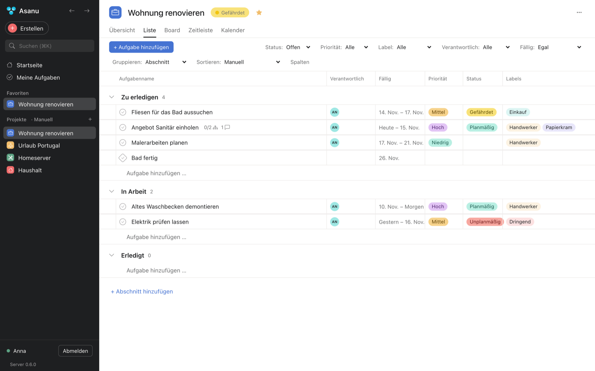
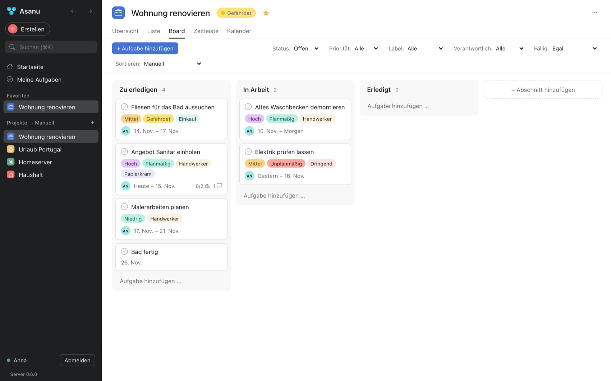
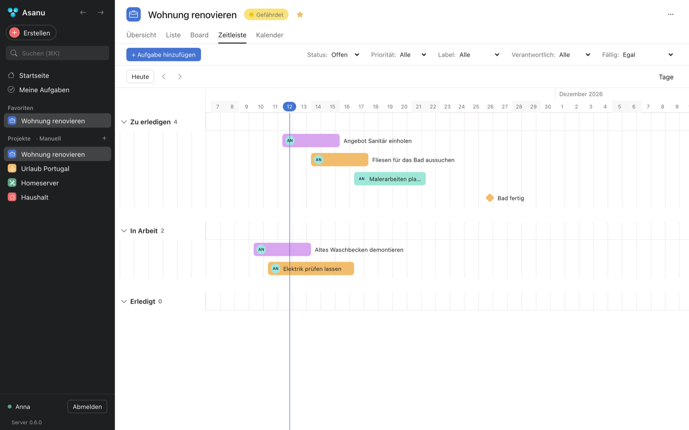
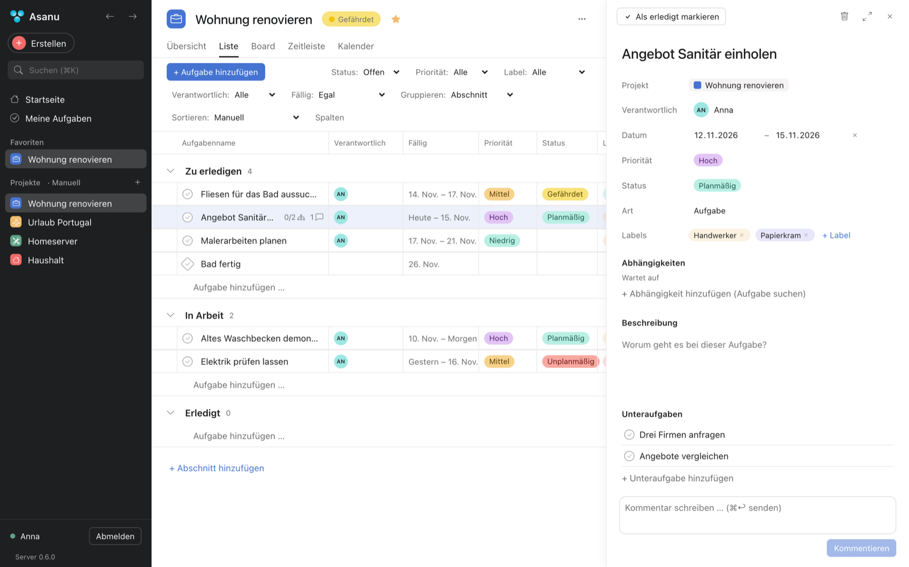
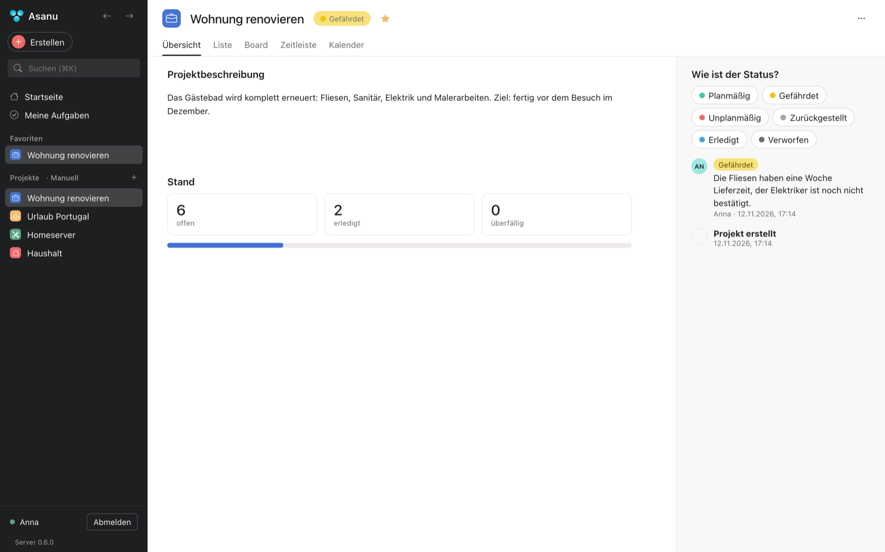
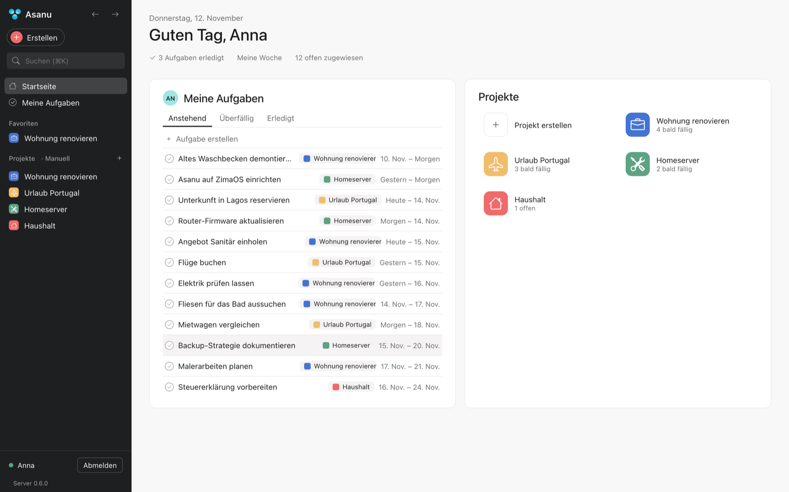
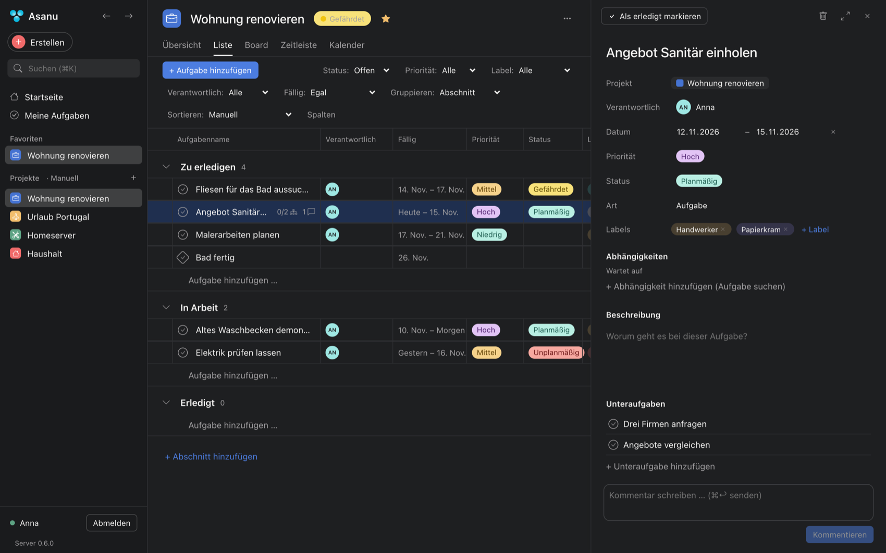
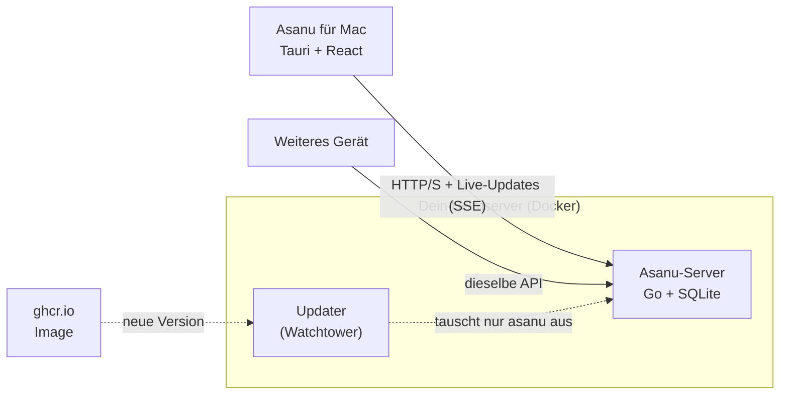

<p align="center">
  
</p>

<h1 align="center">Asanu</h1>

<p align="center">
  <strong>Deine Projekte und Aufgaben – wie bei Asana, aber auf deinem eigenen Server.</strong><br>
  Eine private Projektverwaltung für den Mac, die ohne Cloud, Abo und Konto bei Dritten auskommt.
</p>

<p align="center">
  
  
  
  
</p>

<p align="center">
  
</p>

## Warum Asanu?

Ich mag Asana, besonders die Desktop-App: ruhig, schnell, klar. Aber meine Aufgaben gehören auf meinen eigenen Rechner. Asanu ist deshalb ein **privater Nachbau der Asana-Bedienung** für Menschen, die einen Heimserver haben (zum Beispiel ZimaOS, ein NAS oder einen Mini-PC) und ihre Daten selbst behalten wollen.

- **Deine Daten bleiben bei dir.** Alles liegt in einer SQLite-Datei auf deinem Server. Kein Cloud-Dienst, keine Registrierung, keine Werbung.
- **Mehrere Geräte, ein Stand.** Der Server ist die einzige Quelle der Wahrheit. Änderungen erscheinen sofort auf allen verbundenen Geräten.
- **Sehr genügsam.** Ein winziger Container (~5 MB Image). Im Test brauchte der Server im Leerlauf 3 bis 40 MB RAM.
- **Sieht aus wie Asana.** Dunkle Seitenleiste, helle Arbeitsfläche, kompakte Zeilen, Hover statt Kästen, passende Begriffe auf Deutsch.

## Was kann Asanu?

<table>
<tr>
<td width="50%"><br><b>Liste, Board, Zeitleiste, Kalender</b><br>Derselbe Datenbestand in vier Ansichten. Aufgaben ziehen, gruppieren, sortieren, Spalten ein- und ausblenden.</td>
<td width="50%"><br><b>Zeitleiste</b><br>Balken von Start bis Fälligkeit, Meilensteine, fünf Zoomstufen. Balken lassen sich ziehen und verlängern.</td>
</tr>
<tr>
<td width="50%"><br><b>Aufgaben mit allem Drum und Dran</b><br>Verantwortliche, Zeitraum, Priorität, Status, Labels, Abhängigkeiten, Unteraufgaben und Kommentare. Ruhig gestaltet, grau erst beim Darüberfahren.</td>
<td width="50%"><br><b>Projektübersicht</b><br>Status melden (Planmäßig, Gefährdet, Unplanmäßig …), Beschreibung, Fortschritt und Verlauf.</td>
</tr>
<tr>
<td width="50%"><br><b>Startseite und „Meine Aufgaben“</b><br>Alles, was dir zugewiesen ist, in Abschnitten wie „Heute erledigen“. Projekte mit Symbol, Farbe und Favoriten.</td>
<td width="50%"><br><b>Hell und dunkel</b><br>Folgt der macOS-Einstellung.</td>
</tr>
</table>

Dazu: Echtzeit-Abgleich zwischen Geräten, Schutz vor gleichzeitigem Überschreiben, Suche, Filter, Projekt duplizieren, CSV-Export, Favoriten, Tastenkürzel (⌘K, ⌘⇧N, ⌘0–⌘4 …) und ein **Update-Knopf**, der den Server auf Wunsch selbst aktualisiert.

## So funktioniert es



Die App spricht ausschließlich mit der API. Die Datenbankdatei wird nie zwischen Geräten kopiert. Das Anmelde-Token liegt im macOS-Schlüsselbund.

## Installieren

### 1. Server auf dem Heimserver (ZimaOS, Docker)

1. Lade [`deploy/zimaos-compose.yaml`](deploy/zimaos-compose.yaml) herunter und trage bei `ASANU_INIT_EMAIL`, `ASANU_INIT_PASSWORD` (mindestens 10 Zeichen) und `ASANU_INIT_NAME` dein Wunschkonto ein.
2. In ZimaOS: *App Store → „+“ → Install a customized app → YAML*, Inhalt einfügen, **Install**.

Das war es: Das Image `ghcr.io/andirectli/asanu-server` wird automatisch geladen (Intel und ARM), die Daten liegen in einem Docker-Volume. Alle Details, Backup und Wiederherstellung: [docs/ZIMAOS.md](docs/ZIMAOS.md).
Auch auf anderen Docker-Rechnern läuft die Datei unverändert mit `docker compose up -d`.

### 2. App auf dem Mac

Bisher gibt es die App nur als Quellcode; so baust du sie selbst (siehe [Entwicklung](docs/ENTWICKLUNG.md)):

```bash
cd app && npm ci && npm run tauri build
```

Danach `Asanu.app` aus `app/src-tauri/target/release/bundle/macos/` nach „Programme“ ziehen. Die App ist **nicht signiert**: beim ersten Start Rechtsklick → „Öffnen“.
Dann Serveradresse eintragen (z. B. `http://192.168.1.20:8380`), „Verbindung testen“, mit dem Konto aus Schritt 1 anmelden.

Unterwegs funktioniert die App über dein VPN (z. B. Tailscale oder WireGuard). Eine Portfreigabe im Router ist nicht nötig; Asanu ändert keine Netzwerkeinstellungen.

## Sicherheit und Datenschutz

- Passwörter werden mit bcrypt gespeichert, Sitzungstokens nur als Hash. Dauerhafte Tokens liegen im macOS-Schlüsselbund.
- Der Server läuft ohne Root, mit schreibgeschütztem Dateisystem und ohne Linux-Capabilities.
- Vor jeder Datenbank-Umstellung legt der Server automatisch eine Sicherung an.
- Der Auto-Update-Container braucht Zugriff auf den Docker-Socket. Das ist root-gleich auf deinem Server. Wer das nicht möchte, bleibt auf einer festen Version (Anleitung in der Compose-Datei).
- Im Heimnetz oder VPN läuft die Verbindung ohne https. Den Server **nicht** direkt ins Internet stellen. Für https einen Reverse-Proxy davorsetzen.

## Ehrlicher Stand

Asanu ist ein privates Projekt in aktiver Entwicklung. Getestet sind Server (automatische Tests, zwei gleichzeitige Clients, Neustart, Backup, Auto-Update mit echten Images) und die Oberfläche im Browser und in der gebauten Mac-App. Noch **nicht** gebaut sind unter anderem: mehrere Projekte pro Aufgabe, Beteiligte, Anhänge und Rich-Text. Windows ist vorbereitet, aber ungetestet. Was verglichen mit Asana fehlt, steht in [docs/ASANA-REA-BEFUND.md](docs/ASANA-REA-BEFUND.md); was geprüft wurde, in [docs/TESTBERICHT.md](docs/TESTBERICHT.md).

## Mehr lesen

| | |
|---|---|
| [docs/ZIMAOS.md](docs/ZIMAOS.md) | Server einrichten, Updates, Backup, Zugriff von unterwegs |
| [docs/ENTWICKLUNG.md](docs/ENTWICKLUNG.md) | Bauen, Entwickeln, Tastenkürzel |
| [docs/ARCHITEKTUR.md](docs/ARCHITEKTUR.md) | Warum Go + SQLite, wie der Abgleich funktioniert |
| [docs/ASANA-REA-BEFUND.md](docs/ASANA-REA-BEFUND.md) | Vergleich mit Asana, Lücken und Reihenfolge |
| [docs/TESTBERICHT.md](docs/TESTBERICHT.md) | Was wirklich geprüft wurde, inklusive Messwerte und Grenzen |

## Lizenz und Dank

Asanu steht unter der **MIT-Lizenz**. Die Oberfläche orientiert sich an [manakuro/asana-clone-app](https://github.com/manakuro/asana-clone-app) (MIT, © 2026 manakuro); dessen Lizenztext liegt in `THIRD_PARTY_LICENSE_asana-clone-app.txt`.
Asana ist eine Marke der Asana, Inc. Asanu ist ein unabhängiges Projekt und nicht mit Asana verbunden oder von Asana unterstützt.
